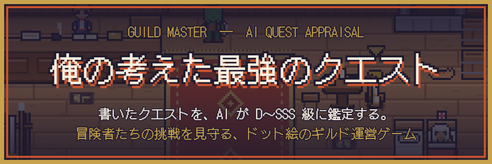
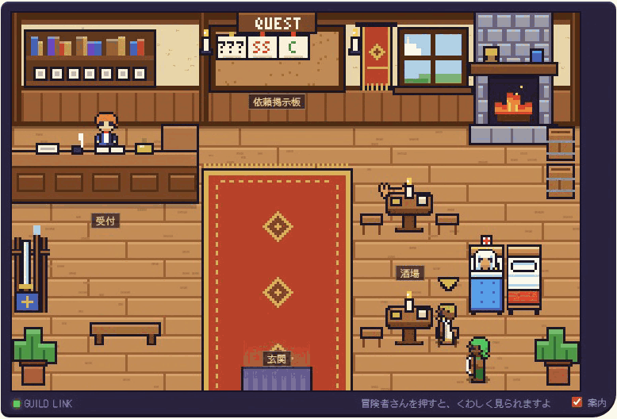
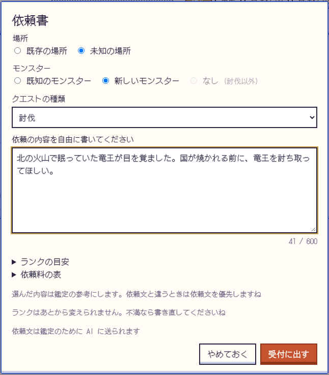
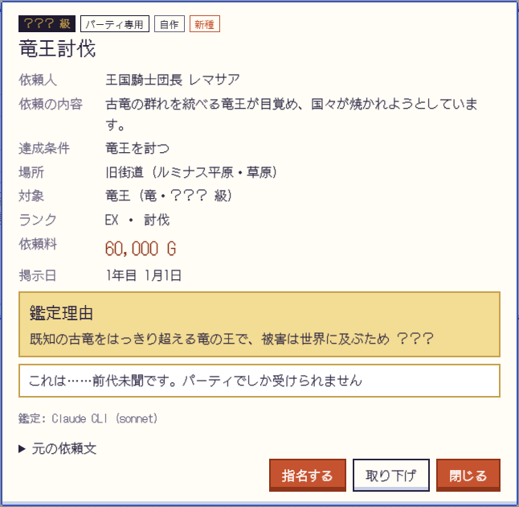
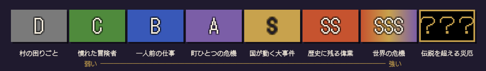
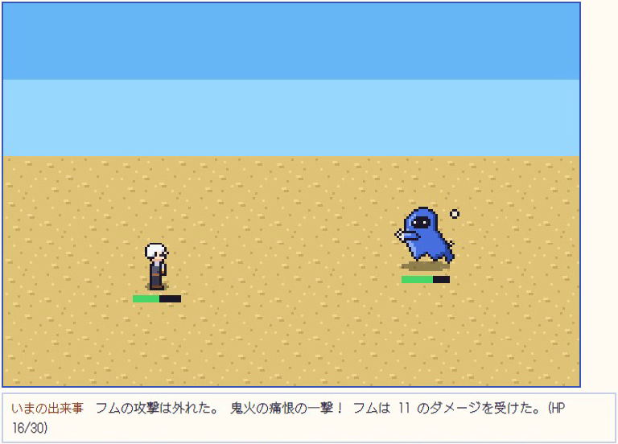
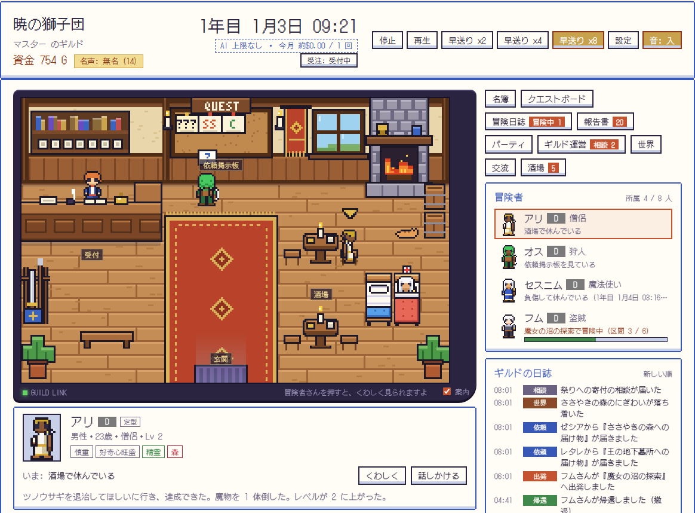

  

  
  
  

<h3 align="center">
  <a href="https://github.com/D0R4CH4N/GuildMaster-release/releases/latest">▶ 最新版をダウンロード</a>
</h3>

  

あなたはギルドマスター。思いついたクエストを自由に書いて、ギルドの掲示板に貼り出しましょう。
鑑定士 (AI) が依頼を読んで D〜SSS 級に鑑定し、冒険者たちが自分で依頼を選んで旅立ちます。
彼らが勝って帰るか、傷だらけで逃げ帰るか — その行く末を、携帯ゲーム機風のドット絵で見守るゲームです。

---

## ✦ どんなゲーム？

### 1. クエストは自由に書く。ランクは AI が決める

「北の火山で眠っていた竜王が目を覚ました。国が焼かれる前に討ち取ってほしい」——
書いた依頼文を AI の鑑定士が読み、相手の強さ・場所の危険さ・被害の大きさから **ランクと依頼料** を決めます。誰も見たことのない魔物や場所を書けば、図鑑に新しく載ります。

<table>
  <tr>
    <td width="50%"></td>
    <td width="50%"></td>
  </tr>
  <tr>
    <td align="center">依頼書を書いて、受付に出す</td>
    <td align="center">「前代未聞です」—— 竜王は ？？？ 級</td>
  </tr>
</table>

  

### 2. 勝ち負けは、AI ではなくルールとサイコロ

冒険の成否・ダメージ・報酬は、冒険者の能力と乱数で決まります。AI が受け持つのは、鑑定と、冒険者の行動選び・語り・会話だけ。
だから「AI が忖度して勝たせる」ことはありません。弱い冒険者に無茶な依頼を任せれば、ちゃんと負けて帰ってきます。

  

### 3. 冒険者は、それぞれ考えて生きている

- 掲示板の依頼を **自分で選んで** 出かけ、帰ると **報告書** や **日記** を書きます。
- 冒険中の仲間へ **念話** で「攻めて」「退いて」と助言できます (聞くかどうかは本人次第)。
- 酒場では雑談や噂話。仲の良い者同士で **パーティ** を組み、昇格試験で D 級から上を目指します。

### 4. ギルドを育て、試練を越える

- 依頼料の一部がギルドの資金に。施設を建て、武具を揃え、冒険者を迎え入れます。
- 15 日ごとにギルド本部から **ギルド試練** が届きます。期限までに果たせなければ、ギルドは看板を下ろしてゲームオーバー。
- 名を残した冒険者は殿堂へ。次のギルドに冒険者を引き継いで、また一から始めることもできます。

  

---

## ▶ はじめかた

1. [最新の Release](https://github.com/D0R4CH4N/GuildMaster-release/releases/latest) から **`GuildMaster-<版>-win-x64.zip`** をダウンロードします。 (`GuildMaster-app-…` と `latest.json` は自動更新用なので、ダウンロードしなくてかまいません)
2. zip を、デスクトップや「ドキュメント」など自分で書き込める場所に展開します。
3. 展開した `GuildMaster` フォルダの **`GuildMaster.bat`** をダブルクリック。黒い窓が開き、少しするとブラウザでゲームが始まります。

遊べる環境は **Windows 10 / 11 (64 ビット)** です。インストールは要りません。くわしい使い方は、zip の中の `README.txt` にあります。

<b>初回に Windows の警告が出たら</b>

 

署名のないファイルなので、初回に警告が出ることがあります。

- 「Windows によって PC が保護されました」と出たら、「詳細情報」→「実行」を押してください。
- 展開する前に、zip を右クリック →「プロパティ」→「許可する (ブロックの解除)」にチェックしておくと、警告が出にくくなります。
- `C:\Program Files` の中や、OneDrive などで同期しているフォルダの中には置かないでください (セーブできない・壊れることがあります)。

<b>AI の準備と料金</b>

 

AI を使う場合は、次のどれか 1 つ以上を用意してください。**AI なしでも、定型のお話で遊べます** (クエストの鑑定だけは AI が必要です)。

- Claude CLI / Codex CLI (それぞれのアカウントでログイン済みのもの)
- Gemini / OpenAI / Anthropic (Claude API) の API キー

AI の利用料は、ご自分のアカウントにかかります。ゲームの設定で、1 日・1 か月の料金の上限を決められます。
AI を使うと、冒険の様子やクエストの文章が、選んだ AI のサービスに送られます。作者のところには何も送られません。
API キーはゲームのフォルダの `data/.env` にだけ保存され、セーブや共有ファイルには入りません。

<b>更新とセーブ</b>

 

- 起動するたびに新しい版があるかを確かめ、黒い窓で「更新しますか？」と聞きます。更新の前に、セーブのバックアップを自動で取ります。
- 更新のファイルには作者の署名が付いていて、署名が合わないものは入りません。
- セーブは `GuildMaster` フォルダの中の `data` フォルダにあります。新しい zip を別のフォルダに展開し直すときは、古いフォルダの `data` を新しい `GuildMaster` フォルダの中へコピーすると、続きから遊べます。
- `data` の中の `.env` には、AI の API キーが入っていることがあります。他の人には渡さないでください。

---

## ✉ 不具合の報告・要望

[Issues](https://github.com/D0R4CH4N/GuildMaster-release/issues/new/choose) から、書式に沿って送ってください。

> [!WARNING]
> **API キーや `data/.env` の中身は、絶対に貼らないでください。** Issues は誰でも読めます。

更新の仕組みや、ゲームを動かしている間の守りに穴を見つけた場合は、Issues ではなく [非公開の報告](https://github.com/D0R4CH4N/GuildMaster-release/security/advisories/new) から知らせてください。作者にだけ届きます。

このリポジトリは配布用です。ゲームのファイルは Releases に置いています (ソースコードは公開していません)。

